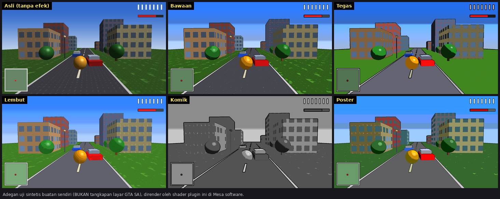

# CelShading-AML — Cel Shading + Outline untuk GTA San Andreas (Android)

Plugin [AML (Android Mod Loader)](https://github.com/RusJJ/AndroidModLoader) yang mengubah tampilan GTA San Andreas
Android jadi **bergaya kartun / cel shading**: warna terang-gelap dibuat berundak (pita), saturasi dinaikkan, dan
**garis tepi (outline) hitam** digambar di sekeliling objek. Semua bisa diatur lewat satu berkas `CelShading.ini`
dan **berubah langsung saat game berjalan** (disimpan → ±1–2 detik kemudian terlihat).



> Gambar di atas adalah **adegan uji sintetis buatan sendiri**, bukan tangkapan layar GTA SA. Gunanya hanya
> menunjukkan efek dan preset di bawah.

---

## Daftar isi
1. [Cara pasang di HP](#cara-pasang-di-hp)
2. [Pengaturan (`CelShading.ini`)](#pengaturan-celshadingini)
3. [Preset siap pakai](#preset-siap-pakai)
4. [Build otomatis lewat GitHub Actions](#build-otomatis-lewat-github-actions)
5. [Bila ada masalah](#bila-ada-masalah)
6. [Keterbatasan & status pengujian (baca ini)](#keterbatasan--status-pengujian-baca-ini)
7. [Cara kerja](#cara-kerja)
8. [Build lokal & tes](#build-lokal--tes)
9. [Struktur proyek](#struktur-proyek)
10. [Lisensi & kredit](#lisensi--kredit)

---

## Cara pasang di HP

**Syarat:** GTA San Andreas Android (paket `com.rockstargames.gtasa`) yang **sudah memakai AML**. Plugin ini hanya
dimuat oleh AML; cara memasang AML ke game dijelaskan di repositori AML.

1. Dapatkan `libCelShading.so` — dari hasil build GitHub Actions (lihat [bagian build](#build-otomatis-lewat-github-actions))
   atau dari rilis. Paketnya berisi dua versi; **pilih SATU sesuai game kamu**:

   | Game | Folder di dalam zip |
   |---|---|
   | GTA SA **2.00** (32-bit) | `armeabi-v7a/libCelShading.so` |
   | GTA SA **2.10** (64-bit) | `arm64-v8a/libCelShading.so` |

   Salah memilih ABI biasanya hanya membuat plugin gagal dimuat (AML mencatat error-nya di log). Jangan salin
   keduanya sekaligus.

2. Salin ke folder mod AML:

   ```
   /sdcard/Android/data/com.rockstargames.gtasa/mods/
   ```

3. Jalankan game satu kali. Plugin membuat `CelShading.ini` otomatis di folder `configs` milik AML. Lokasi persisnya
   dicatat di logcat (tag `CelShading`: *"siap. Edit … untuk mengatur efek"*) — biasanya ada di dalam folder
   `Android/data/com.rockstargames.gtasa/`.
4. Edit `CelShading.ini` dengan editor teks apa saja, simpan, dan lihat hasilnya di game tanpa restart.

Untuk mencopot: hapus `libCelShading.so` dari folder `mods`.

---

## Pengaturan (`CelShading.ini`)

Baris berawalan `;` atau `#` adalah komentar. Kunci yang hilang memakai nilai bawaan; nilai di luar rentang otomatis
dipaksa masuk rentang aman. Berkas bawaan lengkap dengan penjelasan ada di [`config/CelShading.ini`](config/CelShading.ini).

| Kunci | Bawaan | Rentang | Fungsi |
|---|---|---|---|
| `Enabled` | `1` | 0/1 | Nyalakan/matikan seluruh efek |
| `ShadeBands` | `5` | 2–16 | Jumlah tingkat terang-gelap. Kecil = lebih tegas/kartun |
| `BandSoftness` | `0.15` | 0.01–1 | Kehalusan peralihan antar pita (0.01 = tajam) |
| `ShadowFloor` | `0.10` | 0–0.6 | Kecerahan minimum bayangan (supaya tidak hitam pekat) |
| `Saturation` | `1.20` | 0–3 | Saturasi warna. `0` = hitam-putih |
| `Brightness` | `1.00` | 0.3–2 | Pengali kecerahan akhir |
| `ColorPosterize` | `0.00` | 0–1 | Campuran posterisasi warna per kanal (palet terbatas) |
| `ColorLevels` | `6` | 2–32 | Jumlah level per kanal untuk posterisasi |
| `Outline` | `1` | 0/1 | Nyalakan garis tepi |
| `OutlineWidth` | `1.0` | 0.25–6 | Tebal garis, dalam piksel pada layar setinggi 720 (otomatis diskalakan ke resolusimu) |
| `OutlineThreshold` | `0.20` | 0–2 | Ambang kontras warna. Kecil = banyak garis; besar = hanya tepi yang jelas |
| `OutlineSoftness` | `0.12` | 0.01–1 | Kelembutan tepi garis |
| `OutlineStrength` | `1.00` | 0–1 | Kepekatan garis |
| `OutlineColor` | `0 0 0` | 0–255 ×3 | Warna garis (R G B) |
| `Quality` | `1` | 0/1 | `1` = deteksi tepi Sobel (8 sampel), `0` = cepat (4 sampel) |
| `DebugView` | `0` | 0/1/2 | `1` = tampilkan hanya peta garis, `2` = cel shading saja (untuk menyetel) |
| `GameLibrary` | `libGTASA.so` | — | Pustaka game yang di-hook (ubah hanya kalau bukan GTA SA; perlu restart) |

**Menyetel garis:** set `DebugView = 1` — layar jadi putih dengan garis hitam di tempat outline akan muncul. Bintik/garis
berlebihan di tekstur → naikkan `OutlineThreshold` (mis. `0.30`). Garis kurang di tepi objek → turunkan (mis. `0.14`).

---

## Preset siap pakai

Tempel ke `CelShading.ini` (ganti nilai yang sudah ada). Gambar masing-masing ada di pratinjau di atas.

```ini
; --- Tegas (kartun pekat, garis tebal) ---
ShadeBands = 3
BandSoftness = 0.06
Saturation = 1.30
OutlineWidth = 1.6
OutlineThreshold = 0.18

; --- Lembut (halus, garis tipis) ---
ShadeBands = 8
BandSoftness = 0.40
ShadowFloor = 0.18
OutlineWidth = 0.8
OutlineStrength = 0.75

; --- Komik (hitam-putih bergaris) ---
Saturation = 0
ShadeBands = 4
OutlineWidth = 1.8
OutlineThreshold = 0.16

; --- Poster (palet warna terbatas) ---
ShadeBands = 4
ColorPosterize = 0.7
ColorLevels = 5

; --- Hemat FPS (HP kelas bawah) ---
Quality = 0
```

---

## Build otomatis lewat GitHub Actions

Proyek ini sudah siap build tanpa perlu menginstal apa pun di komputer.

1. Buat repositori baru di GitHub, lalu unggah **seluruh isi folder ini** (atau `git push`).
2. Buka tab **Actions** → workflow **Build CelShading (AML)** berjalan otomatis pada setiap push ke `main`/`master`
   (atau tekan **Run workflow** untuk menjalankan manual).
3. Setelah hijau, buka run-nya dan unduh **artifact `CelShading-AML`** di bagian bawah halaman. Isinya:
   `armeabi-v7a/libCelShading.so`, `arm64-v8a/libCelShading.so`, `CelShading.ini`, `BACA-DULU.txt`, README & lisensi.
   Ringkasan ukuran + SHA-256 tiap `.so` ikut tampil di halaman run.
4. **Rilis (opsional):** buat tag versi dan dorong — workflow otomatis membuat halaman Release berisi zip-nya:

   ```
   git tag v1.0.0
   git push origin v1.0.0
   ```

Workflow memasang Android NDK r27c (`27.2.12479018`) bila belum ada di runner, membangun dua ABI dengan `ndk-build`,
lalu memeriksa hasilnya: kedua simbol yang dicari AML (`OnModLoad`, `__GetModInfo`) harus terekspor, tidak boleh
bergantung pada `libc++_shared.so`, dan alignment segmen LOAD ditampilkan (build memakai halaman 16 KB agar cocok
untuk Android 15+).

---

## Bila ada masalah

| Gejala | Yang dicoba |
|---|---|
| Tidak ada efek sama sekali | Pastikan ABI cocok (2.00 → `armeabi-v7a`, 2.10 → `arm64-v8a`), file ada di folder `mods`, dan AML aktif. Lihat log: `adb logcat \| grep CelShading` — harus ada baris *"hook eglSwapBuffers terpasang"*. |
| Log berisi *"plugin TIDAK aktif"* | Hook gagal dipasang. Kirimkan baris log `CelShading` itu saat melapor masalah. |
| Game crash / layar glitch | Hapus `libCelShading.so` dari folder `mods` (atau set `Enabled = 0`). Lalu coba `Quality = 0`. |
| FPS turun | `Quality = 0`; kecilkan `OutlineWidth`; atau `Outline = 0`. |
| Banyak bintik/garis di tekstur | Naikkan `OutlineThreshold` (0.25–0.4). |
| Efek tiba-tiba hilang di tengah game | Plugin mematikan dirinya sendiri bila 3 frame berturut-turut mengalami error GL (demi keamanan game). Restart game; kalau terulang, laporkan log-nya. |

---

## Keterbatasan & status pengujian (baca ini)

**Yang sudah diuji (di PC, bukan di HP):**
- Parser INI; hook GOT sungguhan pada pustaka hasil `dlopen` (termasuk proteksi RELRO); parser ELF dibandingkan dengan
  `llvm-readelf` pada pustaka ARM32, AArch64, x86 dan x86-64 (ribuan relokasi).
- Renderer di Mesa (GPU software) dengan OpenGL ES 3.2 **dan** ES 2.0: seluruh state GL kembali persis seperti sebelum
  efek (termasuk VAO, FBO, PBO, unit tekstur, scissor, blending, atribut vertex), hasil shader cocok dengan
  perhitungan referensi di CPU, dan penanganan resolusi/context berganti.
- Uji menyeluruh dengan "game palsu": hook → render → reload `CelShading.ini` langsung → context hilang → jalur cadangan.

**Yang BELUM diuji — jujur:**
- **Belum pernah dijalankan di Android / GTA SA sungguhan.** Hook dan shader sudah diuji di PC, tapi perilaku GPU HP
  (Adreno/Mali/PowerVR) dan `libGTASA.so` asli tidak bisa saya cek.
- **Belum dikompilasi dengan Android NDK sungguhan** (NDK tidak bisa diunduh di lingkungan tempat plugin ini dibuat).
  Kode sudah dikompilasi bersih dengan g++/clang di PC dan `main.cpp` dengan header AML asli, tetapi *build pertama
  dengan NDK terjadi di GitHub Actions*. Bila gagal, salin log error-nya dan perbaikannya biasanya kecil.

**Batasan desain:**
- Efek diterapkan ke **seluruh layar**, jadi HUD, radar, teks, dan menu ikut berubah (outline tampil di tepi HUD).
  Tidak ada cara memisahkannya pada post-process di saat `eglSwapBuffers`.
- Garis dihitung dari **kontras warna**, bukan kedalaman (depth buffer tidak tersedia di OpenGL ES 2). Akibatnya
  tepi dengan warna hampir sama tidak diberi garis, dan tekstur sangat kontras bisa menghasilkan garis tambahan —
  itu yang diatur `OutlineThreshold`.
- Hook bergantung pada `libGTASA.so` yang mengimpor `eglSwapBuffers` (benar untuk game ini). Kalau tidak ketemu,
  plugin mencoba hook cadangan langsung di `libEGL.so` lewat AML.
- Relokasi yang dikompres (`DT_ANDROID_REL(A)` / `DT_RELR`) tidak dibaca; slot PLT tetap ditemukan, jadi tidak
  masalah untuk kasus normal.
- Perubahan `GameLibrary` perlu restart game; semua kunci lain berlaku langsung.

---

## Cara kerja

1. **Hook tanpa offset.** Plugin memindai tabel impor (GOT/PLT) milik `libGTASA.so` dan mengganti entri
   `eglSwapBuffers` dengan fungsinya sendiri — tidak ada alamat/offset khusus versi game. Pembaca ELF-nya mandiri
   (tidak bergantung pada `<elf.h>`) dan paham ARM32, AArch64, dan x86.
2. **Post-process per frame**, tepat sebelum `eglSwapBuffers` asli: framebuffer disalin ke tekstur
   (`glCopyTexSubImage2D`), lalu satu segitiga layar-penuh digambar dengan fragment shader GLSL ES 1.00.
3. **Shader:** luminans dikuantisasi jadi beberapa pita (rona dipertahankan, bayangan diangkat sedikit), lalu
   saturasi/kecerahan/posterisasi; garis tepi dari deteksi kontras warna (Sobel 8 sampel atau Roberts-cross 4 sampel),
   jarak sampel diskalakan terhadap tinggi layar sehingga tebal garis konsisten di semua resolusi.
4. **Aman terhadap engine game:** semua state GL yang disentuh disimpan lalu dipulihkan persis (termasuk VAO, FBO baca/tulis,
   PBO, unit tekstur, sampler, atribut vertex, scissor/blend/depth/stencil). Efek dilewati kalau context/surface tidak
   cocok, dan mati sendiri bila terjadi error GL berturut-turut. Hook `eglDestroyContext`/`eglTerminate` memastikan ID
   objek GL lama tidak dipakai lagi.

---

## Build lokal & tes

**Build plugin** (butuh Android NDK r27c):

```sh
export ANDROID_NDK_HOME=/jalur/ke/ndk/27.2.12479018
"$ANDROID_NDK_HOME/ndk-build" NDK_PROJECT_PATH="$PWD" APP_BUILD_SCRIPT="$PWD/Android.mk" \
    NDK_APPLICATION_MK="$PWD/Application.mk" NDK_DEBUG=0
# hasil: libs/armeabi-v7a/libCelShading.so  dan  libs/arm64-v8a/libCelShading.so
```

**Tes di PC** (Linux; tidak butuh GPU maupun Android):

```sh
make -C tests                 # semua tes yang bisa jalan di mesin ini
make -C tests config|got|elf|gl|e2e
```

Tes `gl` dan `e2e` memakai Mesa software (`apt install libegl1 libgles2 libgl1-mesa-dri libegl-mesa0`) dan header
Khronos EGL/GLES2 (`apt install libegl-dev libgles-dev`, atau arahkan `GL_INC`; lihat komentar di `tests/Makefile`).
Pemeriksaan ELF lintas-arsitektur butuh `clang`, `ld.lld`, dan `llvm-readelf` (dilewati bila tidak ada).

---

## Struktur proyek

```
.github/workflows/build.yml   workflow build + paket + rilis
Android.mk, Application.mk    build ndk-build (armeabi-v7a, arm64-v8a)
config/CelShading.ini         berkas pengaturan bawaan (sama persis dengan teks di kode)
docs/preview.png              pratinjau (adegan uji sintetis)
src/main.cpp                  adaptor tipis AML (MYMOD, ON_MOD_LOAD)
src/cel_plugin.*              inisialisasi, hook, reload INI (tanpa ketergantungan AML)
src/cel_renderer.*            post-process OpenGL ES + simpan/pulihkan state
src/cel_config.*              pengaturan + parser/penulis INI
src/got_hook.*, elf_scan.h    hook tabel GOT + pembaca ELF mandiri
mod/                          header AML (salinan, MIT) — lihat mod/LICENSE-AML.txt
tests/                        tes host: config, ELF, hook GOT, renderer (Mesa), end-to-end
```

---

## Lisensi & kredit

MIT — lihat [`LICENSE`](LICENSE). Folder `mod/` berisi header dan logger dari
[AndroidModLoader](https://github.com/RusJJ/AndroidModLoader) oleh RusJJ (juga MIT; lisensinya di
`mod/LICENSE-AML.txt`). Proyek ini tidak berafiliasi dengan Rockstar Games; GTA San Andreas adalah milik pemegang haknya.
